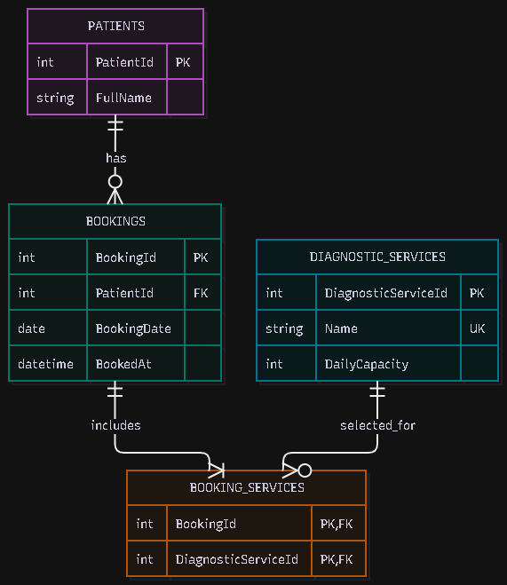

# CareFlow relational design

`BookingServices` is the join table for the many-to-many relationship between bookings and diagnostic services. Its composite primary key prevents the same service from being attached twice to one booking. A service's remaining capacity for a date is its daily capacity minus the number of matching `BookingServices` linked to bookings on that date. Foreign keys preserve patient and service references; deleting a referenced patient or service is restricted.
